# Relatório Técnico Completo
## Projeto 2: Classificação Automática de Sentimentos em Avaliações de Produtos (PLN)

- **Instituição:** Instituto Federal de Educação, Ciência e Tecnologia da Paraíba (IFPB)
- **Curso:** Bacharelado em Engenharia da Computação
- **Disciplina:** Inteligência Artificial — Unidade 3
- **Professor:** Marcelo José Siqueira Coutinho de Almeida
- **Data de Entrega:** Novembro de 2026
- **Equipe Responsável:**
  - **Guilherme Gonçalves** *(Engenharia de Dados, Análise Exploratória e Pré-processamento PLN)*
  - **Anaíza Silva** *(Representação Vetorial, Modelagem Supervisionada e Ajuste de Hiperparâmetros)*
  - **Hillary Maximino** *(Avaliação Experimental Crítica, Análise de Erros, Ética e Aplicação Streamlit)*
- **Repositório do Projeto:** [`github.com/guizyre/projeto-ia-sentimentos-b2w`](https://github.com/guizyre/projeto-ia-sentimentos-b2w)

---

## Resumo Executivo

Este relatório documenta o desenvolvimento, a avaliação experimental e a implementação demonstrável de um sistema completo de **Processamento de Linguagem Natural (PLN)** para classificação automática de sentimentos (**Negativo**, **Neutro** e **Positivo**) em avaliações reais de produtos em língua portuguesa. Utilizou-se o corpus aberto **B2W-Reviews01** (`132.373` avaliações brutas; `126.690` avaliações válidas após auditoria e limpeza rigorosas, com remoção integral de colunas pessoais). Investigou-se o impacto da preservação de acentuação gráfica e de palavras de negação (`79,28%` de presença na classe Negativa), comparando quatro esquemas de representação vetorial (*Bag of Words* e *TF-IDF*, com unigramas e uni+bigramas) combinados a quatro variantes de algoritmos supervisionados (*Multinomial Naive Bayes*, *Regressão Logística* padrão e balanceada, e *Linear SVM* balanceado), além de ajuste de hiperparâmetros via validação cruzada estratificada estritamente sobre o conjunto de treino (`n_train = 101.352`), prevenindo qualquer vazamento de dados (*data leakage*).

No conjunto de teste retido (`n_test = 25.338`), o modelo campeão selecionado por validação cruzada — **TF-IDF (Uni+Bigramas, `sublinear_tf=True`, `min_df=3`) + Linear SVM (`class_weight='balanced'`, `C=0,1`)** — alcançou **F1-Score Macro de `0,7318`**, **Acurácia global de `83,78%`** e **Recall Negativo de `91,38%`**. A análise crítica dos `4.111` erros revelou que **`80,98%` das confusões envolvem a classe Neutra** (nota 3) e **`26,42%` correspondem a avaliações multi-aspecto** (elogio ao produto combinado a queixas logísticas). Comprovou-se estatisticamente a presença de ruído na supervisão fraca por estrelas (inconsistência `3,5×` a `5,7×` superior com o campo `recommend_to_a_friend` nos erros extremos) e demonstrou-se que, no cenário binário (sem a nota 3), o mesmo classificador eleva seu **F1-Macro para `0,9388`** e sua **Acurácia para `94,77%`**. Por fim, consolidou-se todo o pipeline em uma aplicação interativa moderna em **Streamlit** (`app.py`) com explicabilidade local por token/bigrama.

---

## 1. Introdução e Caracterização do Problema

Plataformas de comércio eletrônico acumulam diariamente milhares de avaliações textuais nas quais consumidores relatam percepções sobre qualidade construtiva, relação custo-benefício, conformidade com o anúncio e cumprimento de prazos logísticos. A inspeção manual desse volume de textos livres é operacionalmente inviável, tornando a **Classificação Automática de Sentimentos** uma tarefa central de Processamento de Linguagem Natural (PLN) e Aprendizado de Máquina.

### 1.1 Objetivos do Projeto
O objetivo geral deste trabalho é projetar, implementar, comparar experimentalmente e disponibilizar em interface interativa um pipeline reprodutível de PLN em Python capaz de classificar avaliações de produtos em português nas classes **Negativo (`0`)**, **Neutro (`1`)** e **Positivo (`2`)**. Especificamente, busca-se:
1. Auditar e higienizar o corpus **B2W-Reviews01**, assegurando conformidade legal com sua licença e proteção estrita à privacidade dos avaliadores (Seção 2.8 do edital);
2. Fundamentar e comprovar empiricamente as decisões de pré-processamento linguístico em português, com ênfase na preservação de acentuação e de operadores de negação/contraste;
3. Avaliar sistematicamente o efeito de representações *Bag of Words* vs. *TF-IDF* e de *unigramas* vs. *bigramas* sobre múltiplas famílias de classificadores supervisionados sem vazamento de dados;
4. Responder com rigor quantitativo e exemplos reais às **cinco questões experimentais da Seção 2.6** (melhor configuração, sensibilidade a reclamações, tipologia de erros, ruído de rotulagem por estrelas e estabilidade entre categorias de produtos);
5. Entregar uma aplicação web local em **Streamlit** (`app.py`) que permita testar avaliações inéditas em tempo real e inspecionar os termos que governam cada decisão.

---

## 2. Caracterização do Corpus, Licença e Governança de Privacidade

### 2.1 Origem, Versão, Data de Acesso e Licença
O projeto utiliza o corpus público **B2W-Reviews01**, compilado e disponibilizado pela equipe da B2W Digital / Americanas Tech (REAL et al., 2019):

| Metadado Técnico | Especificação Registrada |
| :--- | :--- |
| **Nome oficial do conjunto** | `B2W-Reviews01` |
| **Repositório oficial (fonte primária)** | [`https://github.com/americanas-tech/b2w-reviews01`](https://github.com/americanas-tech/b2w-reviews01) |
| **Espelho alternativo documentado** | [`https://huggingface.co/datasets/ruanchaves/b2w-reviews01`](https://huggingface.co/datasets/ruanchaves/b2w-reviews01) |
| **Versão do dataset** | `v1.0` (distribuição oficial `B2W-Reviews01.csv`) |
| **Data de acesso e obtenção** | **23 de novembro de 2026** |
| **Período original de coleta** | `01/01/2018 00:11:28` a `31/05/2018 23:50:33` (*Americanas.com*) |
| **Idioma** | Português brasileiro (`pt-BR`) |
| **Volume bruto original** | `132.373` registros × `14` colunas |
| **Licença de uso** | **CC BY-NC-SA 4.0** (*Atribuição-NãoComercial-CompartilhaIgual 4.0 Internacional*) |

Em estrita observância à licença **CC BY-NC-SA 4.0** e à Seção 6 do edital, o arquivo bruto `B2W-Reviews01.csv` **não é redistribuído** no repositório Git (bloqueado via `.gitignore`). O módulo `src/data_loader.py` implementa a função automatizada `download_b2w_dataset()` para obtenção direta da fonte oficial, garantindo reprodutibilidade integral.

### 2.2 Seleção de Atributos e Descarte de Dados Pessoais (Seção 2.8)
Logo na etapa de ingestão (`remove_personal_data()` em `src/data_loader.py`), todos os identificadores individuais e atributos demográficos são **permanentemente descartados**:
- **Colunas sensíveis removidas (4):** `reviewer_id`, `reviewer_birth_year`, `reviewer_gender` e `reviewer_state`.
- **Atributos mantidos para modelagem e auditoria:**
  - *Entrada textual:* `review_text` (preservada intacta em `review_text_original` e normalizada em `review_text_clean`);
  - *Variável de origem do rótulo:* `overall_rating` (nota inteira de 1 a 5 estrelas);
  - *Metadados analíticos não pessoais:* `site_category_lv1` (avaliação por categoria de produto na Seção 8.5), `recommend_to_a_friend` (auditoria estatística de ruído nos rótulos na Seção 8.4), `review_title` e `submission_date`.

Testes unitários automatizados (`tests/test_pipeline.py`) verificam que nenhuma coluna pessoal persiste nos DataFrames, resumos JSON ou na interface Streamlit.

---

## 3. Auditoria, Limpeza, Rotulagem e Análise Exploratória (EDA)

### 3.1 Funil de Auditoria e Higienização dos Dados
A auditoria executada por **Guilherme Gonçalves** em `src/data_loader.py` e documentada em `notebooks/01_eda_e_limpeza.ipynb` contabilizou cada etapa de filtragem até a base consolidada:

| Etapa do Funil de Higienização | Registros Restantes | Removidos na Etapa | % Retido |
| :--- | ---: | ---: | ---: |
| **0.** Corpus bruto original (`B2W-Reviews01.csv`) | 132.373 | — | 100,00% |
| **1.** Remoção de nulos em `review_text`/`overall_rating` ou nota fora de `1..5` | 129.098 | 3.275 | 97,53% |
| **2.** Remoção de textos vazios ou sem conteúdo alfabético (`< 3` chars ou `< 2` letras) | 128.986 | 112 | 97,44% |
| **3.** Remoção de duplicatas exatas no par `(review_text, overall_rating)` | 126.691 | 2.295 | 95,71% |
| **4.** Remoção de registro residual esvaziado pós-filtragem de *stopwords* | **126.690** | 1 | **95,71%** |

### 3.2 Regra de Mapeamento de Notas e Desequilíbrio de Classes
Adotou-se o mapeamento ternário padrão da literatura de mineração de opinião em e-commerce (Seção 2.4.2):
- **Notas 1 e 2 → Negativo (`0`):** `32.599` avaliações (**`25,73%`** — sendo `24.607` nota 1 e `7.992` nota 2);
- **Nota 3 → Neutro (`1`):** `15.843` avaliações (**`12,51%`**);
- **Notas 4 e 5 → Positivo (`2`):** `78.249` avaliações (**`61,76%`** — sendo `31.782` nota 4 e `46.467` nota 5).

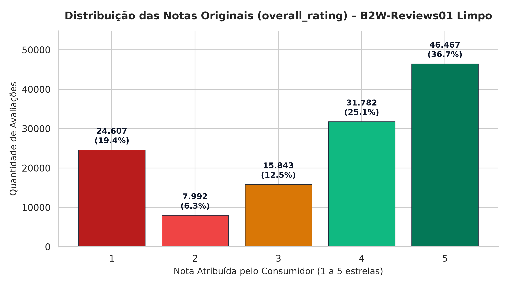

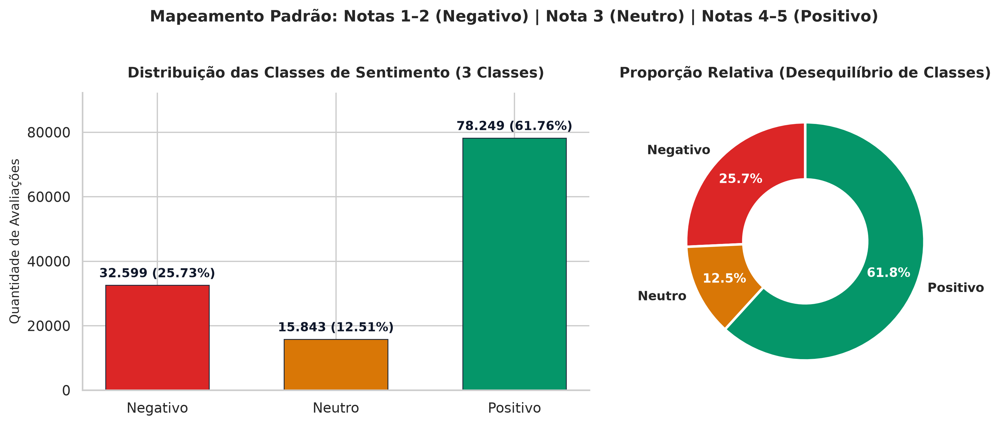

**Análise crítica da rotulagem preliminar:**
1. **Forte assimetria de classes (`4,94 : 1`):** A classe Positiva (`61,76%`) é quase cinco vezes mais numerosa que a Neutra (`12,51%`). Um classificador trivial que ignorasse completamente avaliações neutras ainda obteria acurácia enganosamente elevada (>80%). Isso justifica a adoção do **F1-Score Macro** como métrica primária de decisão em todo o projeto.
2. **Supervisão fraca e ruído intrínseco:** Já na EDA identificaram-se **`69` textos idênticos** rotulados com notas conflitantes por clientes distintos, **`2.685` avaliações (`2,12%`)** com nota 1–2 que marcaram `recommend_to_a_friend == "Yes"` e **`1.152` avaliações (`0,91%`)** com nota 4–5 que marcaram `"No"`.

### 3.3 Comprimento Textual, Categorias de Produtos e Amostragem Estratificada
- **Comprimento por sentimento (Figura 03):** Consumidores insatisfeitos detalham problemas e atrasos em textos quase duas vezes mais extensos — média de **`32,33` palavras** no **Negativo** (mediana `24`, P90 = `63`), contra **`23,95` palavras** no **Neutro** (mediana `17`) e **`18,70` palavras** no **Positivo** (mediana `14`).
- **Heterogeneidade setorial (Figura 04):** *Celulares e Smartphones* lidera em volume (`20.091` avaliações; `69,7%` positivas), seguida por *Eletroportáteis* (`11.444`; `71,1%` positivas). Em contrapartida, **Móveis** (`6.634` avaliações) exibe inversão crítica de polaridade, com **`43,9%` de avaliações negativas** e `16,2%` neutras contra apenas `39,9%` positivas.
- **Execução sobre o corpus integral:** Embora a função `get_stratified_sample(n_samples=30000)` tenha sido implementada e validada preservando proporções exatas (`61,76% / 25,73% / 12,51%`), a equipe optou por executar **todos os treinamentos, validações cruzadas e análises de erro sobre a totalidade das `126.690` avaliações válidas**, maximizando a representatividade estatística.

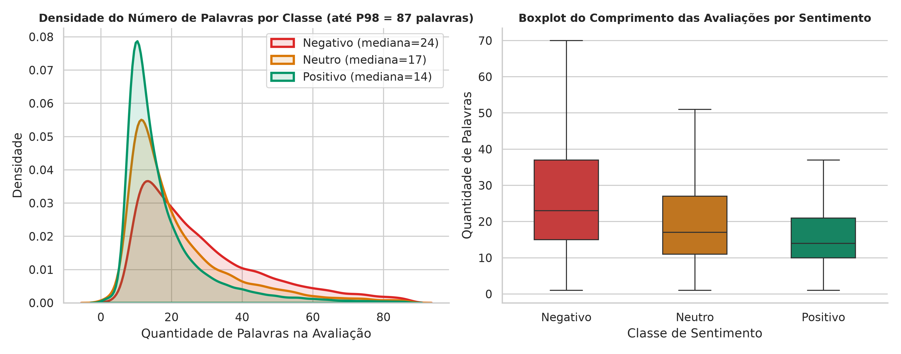

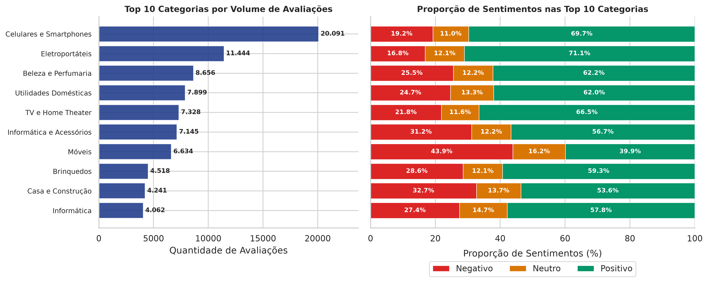

---

## 4. Pipeline de Pré-processamento Textual em Português (PLN)

O módulo `src/preprocessing.py` (analisado em `notebooks/02_preprocessamento_pln.ipynb`) implementa seis transformações sequenciais projetadas especificamente para preservar marcadores semânticos de polaridade em português:

1. **Higienização estrutural:** Decodificação de entidades HTML (`html.unescape`) e remoção de tags HTML, URLs (`http/https/www`) e e-mails.
2. **Normalização em caixa baixa com preservação integral de acentuação:** Mantêm-se intactos todos os caracteres diacríticos do português (`á, à, â, ã, é, ê, í, ó, ô, õ, ú, ü, ç`). A remoção cega de acentos fundiria palavras gramaticalmente distintas (`é` vs. `e`, `está` vs. `esta`) e empobreceria adjetivos polares (`ótimo`, `péssimo`, `horrível`). No corpus limpo, **`265.048` ocorrências de tokens (`14,45%` do total)** e **`6.625` vocábulos distintos** contêm acentuação preservada.
3. **Compressão de alongamentos expressivos:** Sequências de 3+ letras idênticas (`"muitooooo"`, `"péssimooo"`) são reduzidas a duas ocorrências, preservando dígrafos vernáculos (`rr`, `ss`).
4. **Tokenização alfabética PT-BR:** Expressão regular `[a-záàâãéêíóôõúüç]+` eliminando pontuações soltas e numerais isolados (`min_token_len = 2`).
5. **Filtragem customizada de *stopwords* com proteção explícita de negações e modificadores:** Da lista oficial de `207` *stopwords* do NLTK para português, **foram resgatados `7` termos essenciais de polaridade e contraste** — **`não`, `nem`, `sem`, `muito`, `mais`, `mas` e `só`** (reduzindo a lista de exclusão para `200` termos), além de assegurar a proteção integral de `nunca`, `jamais`, `nada`, `nenhum`, `nenhuma`, `ninguém`, `tampouco`, `porém`, `contudo`, `entretanto`, `todavia` e `pouco`.
6. **Marcação opcional de escopo de negação (*Negation Marking*):** Parâmetro `mark_negation=True` unindo gatilhos negativos ao token subsequente (`"não recomendo"` → `"não_recomendo"`, `"nunca mais"` → `"nunca_mais"`).

### 4.1 Comprovação Empírica da Preservação de Negações e Padrões Lexicais

| Avaliação Original Real (B2W-Reviews01) | NLTK Padrão (Sem Proteção ❌) | Pipeline do Projeto (Acentos + Negações ✅) |
| :--- | :--- | :--- |
| *"O produto é completamente diferente da descrição e da foto. Não recomendo."* (1 ★) | `produto completamente diferente descrição foto recomendo` *(inverteu!)* | `produto completamente diferente descrição foto não recomendo` |
| *"Impossível avaliar um produto o qual ainda não recebi! DECEPCIONANTE! Americanas.com, NUNCA MAIS!!!"* (2 ★) | `impossível avaliar produto ainda recebi decepcionante americanas nunca` | `impossível avaliar produto ainda não recebi decepcionante americanas nunca mais` |
| *"Ótimo custo-benefício, abre todos os programas pesados, rápido e não trava."* (5 ★) | `ótimo custo benefício abre todos programas pesados rápido trava` *(inverteu!)* | `ótimo custo benefício abre todos programas pesados rápido não trava` |

- **Redução de ruído funcional (Figura 06):** O total de tokens caiu de `2.874.823` para `1.833.713` (**`-36,21%`**), retendo `46.780` termos únicos informativos (`"produto"`, `"não"`, `"muito"`, `"bom"`, `"recomendo"`, `"entrega"`, `"mas"`).
- **Assimetria dramática das negações (Figura 05):** **`79,28%`** das avaliações **Negativas** possuem ao menos um operador de negação (**`72,35%`** contêm `"não"/"nao"`), contra `40,47%` das **Neutras** e apenas `20,86%` das **Positivas**.
- **Separação semântica em bigramas e WordClouds (Figuras 07 e 08):**
  - *Negativo:* `"não recebi"` (`4.155`), `"produto não"` (`2.590`), `"não recomendo"` (`2.405`), `"ainda não"` (`2.237`), `"não chegou"` (`1.173`), `"não funciona"` (`984`), `"veio defeito"` (`809`).
  - *Neutro:* `"produto bom"` (`1.318`), `"muito bom"` (`1.165`), `"ainda não"` (`469`), `"mas não"` (`382`), `"bom mas"` (`379`) — evidenciando a mistura de elogio e ressalva.
  - *Positivo:* `"muito bom"` (`11.577`), `"antes prazo"` (`6.551`), `"gostei muito"` (`4.205`), `"super recomendo"` (`3.243`), `"ótima qualidade"` (`2.944`), `"entrega rápida"` (`2.629`).

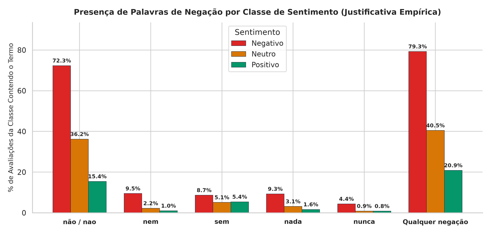

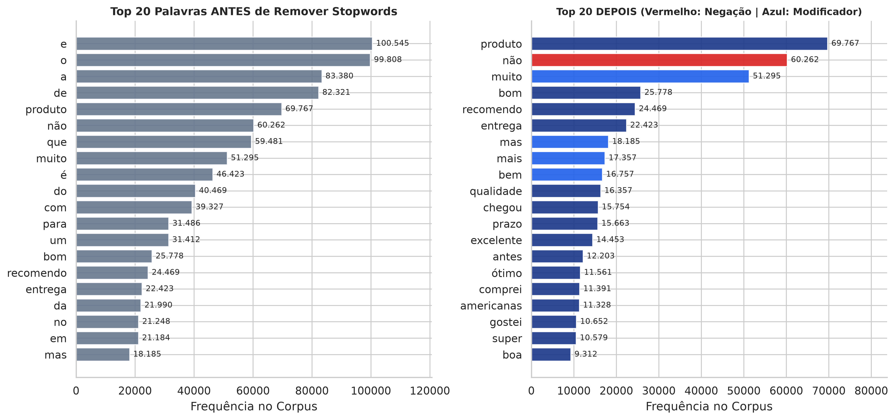

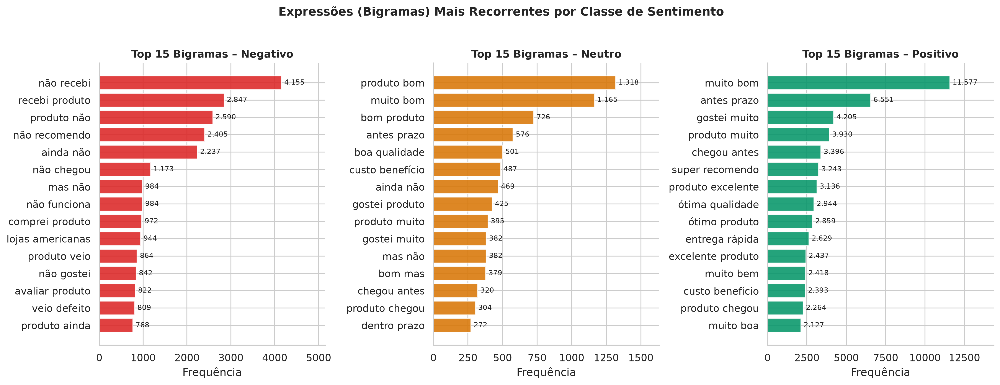

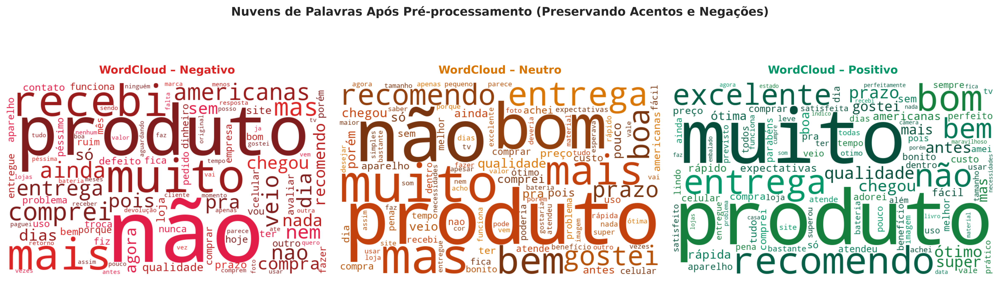

---

## 5. Metodologia de Representação Vetorial e Modelagem Supervisionada

### 5.1 Divisão Estratificada e Prevenção Estrita de *Data Leakage*
No módulo `src/models.py` e no notebook `notebooks/03_treinamento_modelos.ipynb` (**Anaíza Silva**), as `126.690` avaliações foram particionadas via `train_test_split(test_size=0.20, stratify=y, random_state=42)`:
- **Conjunto de Treino (`X_train`, `y_train`):** `101.352` avaliações (`80,0%`);
- **Conjunto de Teste (`X_test`, `y_test`):** `25.338` avaliações (`20,0%` — sendo `6.520` Negativas, `3.169` Neutras e `15.649` Positivas).

Em cumprimento rigoroso à Seção 2.5.4 do edital:
1. O ajuste de vocabulário e pesos IDF (`.fit()`) ocorreu **exclusivamente sobre `X_train`**; `X_test` recebeu apenas `.transform()`;
2. Todo ajuste de hiperparâmetros (`GridSearchCV`) utilizou `sklearn.pipeline.Pipeline([("vec", ...), ("clf", ...)])` sobre `X_train` com `StratifiedKFold(n_splits=3, shuffle=True, random_state=42)`, recalculando vocabulário e IDF dentro de cada dobra de treino;
3. A escolha do modelo final baseou-se **unicamente no F1-Macro médio de validação cruzada**, jamais consultando `X_test`.

### 5.2 Configurações de Vetorização e Classificadores Comparados
Avaliaram-se **4 representações vetoriais** (`min_df=3`, `token_pattern=r"[a-záàâãéêíóôõúüç_]+"`):

| Código | Esquema Vetorial | Faixa de N-gramas | Dimensionalidade (`X_train`) |
| :--- | :--- | :---: | ---: |
| `bow_uni` | *Bag of Words* (`CountVectorizer`) | `(1, 1)` — Unigramas | `15.978` features |
| `bow_bi` | *Bag of Words* (`CountVectorizer`) | `(1, 2)` — Uni + Bigramas | `78.918` features |
| `tfidf_uni` | *TF-IDF* (`TfidfVectorizer`, `sublinear_tf=True`) | `(1, 1)` — Unigramas | `15.978` features |
| `tfidf_bi` | *TF-IDF* (`TfidfVectorizer`, `sublinear_tf=True`) | `(1, 2)` — Uni + Bigramas | `78.918` features |

Cruzadas com **4 configurações de algoritmos supervisionados**:
- **Multinomial Naive Bayes (`nb`):** modelo generativo probabilístico clássico para contagens lexicais;
- **Regressão Logística padrão (`logreg`):** `LogisticRegression(max_iter=1000, class_weight=None)`;
- **Regressão Logística balanceada (`logreg_bal`):** `LogisticRegression(max_iter=1000, class_weight='balanced')`, reponderando inversamente à frequência de cada classe;
- **Linear SVM balanceado (`svm_bal`):** `LinearSVC(class_weight='balanced', random_state=42)`, classificador de margem máxima eficiente em espaços esparsos de alta dimensão.

---

## 6. Resultados da Grade Padrão (16 Combinações)

| # | Representação | Classificador | Acurácia | F1-Macro ★ | F1 Neg. | F1 Neu. | F1 Pos. | Rec. Neg. | Rec. Neu. |
| :-: | :--- | :--- | ---: | ---: | ---: | ---: | ---: | ---: | ---: |
| 1 | TF-IDF uni+bi | LogReg `balanced` | 0,7992 | **0,7233** | 0,8634 | **0,4398** | 0,8666 | 0,8917 | 0,5484 |
| 2 | TF-IDF uni+bi | Linear SVM `balanced` | 0,8221 | 0,7100 | 0,8610 | 0,3779 | 0,8911 | 0,8913 | 0,3588 |
| 3 | BoW uni+bi | Naive Bayes | 0,8143 | 0,7073 | 0,8404 | 0,3914 | 0,8903 | 0,8666 | 0,3932 |
| 4 | BoW uni+bi | LogReg `balanced` | 0,8006 | 0,7069 | 0,8534 | 0,3948 | 0,8725 | 0,8727 | 0,4418 |
| 5 | TF-IDF uni+bi | LogReg padrão | **0,8452** | 0,6993 | **0,8729** | 0,3193 | **0,9058** | **0,9072** | 0,2256 |
| 6 | TF-IDF uni | LogReg `balanced` | 0,7681 | 0,6981 | 0,8424 | 0,4100 | 0,8419 | 0,8627 | **0,5614** |
| 7 | BoW uni+bi | LogReg padrão | 0,8302 | 0,6978 | 0,8602 | 0,3359 | 0,8973 | 0,8753 | 0,2745 |
| 8 | TF-IDF uni | Linear SVM `balanced` | 0,8035 | 0,6937 | 0,8355 | 0,3663 | 0,8793 | 0,8635 | 0,3664 |
| 9 | BoW uni | LogReg `balanced` | 0,7669 | 0,6902 | 0,8260 | 0,3980 | 0,8466 | 0,8367 | 0,5270 |
| 10 | BoW uni | Naive Bayes | 0,7952 | 0,6770 | 0,8161 | 0,3360 | 0,8790 | 0,8293 | 0,3332 |
| 11 | BoW uni+bi | Linear SVM `balanced` | 0,7958 | 0,6767 | 0,8334 | 0,3226 | 0,8742 | 0,8367 | 0,3175 |
| 12 | TF-IDF uni | LogReg padrão | 0,8319 | 0,6755 | 0,8518 | 0,2770 | 0,8979 | 0,8831 | 0,1915 |
| 13 | BoW uni | Linear SVM `balanced` | 0,7910 | 0,6754 | 0,8124 | 0,3396 | 0,8742 | 0,8256 | 0,3405 |
| 14 | BoW uni | LogReg padrão | 0,8183 | 0,6684 | 0,8363 | 0,2774 | 0,8916 | 0,8505 | 0,2124 |
| 15 | TF-IDF uni+bi | Naive Bayes | 0,8271 | 0,5969 | 0,8504 | 0,0470 | 0,8934 | 0,8928 | 0,0243 |
| 16 | TF-IDF uni | Naive Bayes | 0,8103 | 0,5874 | 0,8201 | 0,0598 | 0,8823 | 0,8505 | 0,0322 |

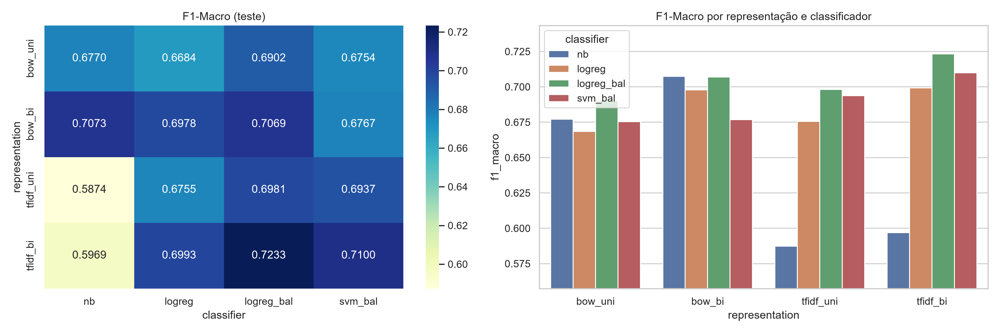

**Achados centrais da grade padrão:**
- **Superioridade do TF-IDF nos classificadores lineares:** Nas 6 comparações pareadas envolvendo Regressão Logística e SVM, o TF-IDF com escala sublinear superou o BoW em 100% dos casos (`+0,0015` a `+0,0333` em F1-Macro), amortecendo palavras de alta frequência genérica (`"produto"`).
- **Ganho consistente dos bigramas:** A inclusão de bigramas elevou o F1-Macro médio de `0,6707` para `0,6898` (`+0,0191`), capturando expressões compostas decisivas (`"não recomendo"`, `"antes prazo"`, `"bom mas"`).
- **Efeito do balanceamento de pesos (`class_weight='balanced'`):** Na Regressão Logística, o F1 médio da classe Neutra subiu de `0,3024` para `0,4107` (`+10,8` pontos).
- **Sensibilidade do Naive Bayes ao `alpha` em TF-IDF:** Com suavização de Laplace padrão (`alpha=1,0`), os valores fracionários do TF-IDF são dominados pela probabilidade *a priori* da classe majoritária, derrubando o Recall Neutro para `~2,4%`; com contagens inteiras (`BoW uni+bi`), o Naive Bayes é altamente competitivo (`F1-Macro = 0,7073`).

---

## 7. Ajuste de Hiperparâmetros, Termos Influentes e *Negation Marking*

### 7.1 Ajuste por Validação Cruzada em `X_train` (`tfidf_bi`)

| Classificador | Grade Explorada (`X_train`) | Melhor Hiperparâmetro | F1-Macro (CV 3-fold) | F1-Macro (Teste) | Acurácia (Teste) |
| :--- | :--- | :---: | ---: | ---: | ---: |
| **Linear SVM (`balanced`) ★** | `C ∈ {0,03; 0,1; 0,3; 1}` | **`C = 0,1`** | **`0,7248`** | **`0,7318`** | **`0,8378`** |
| Regressão Logística (`balanced`) | `C ∈ {0,5; 1; 3; 10}` | `C = 1` | `0,7171` | `0,7233` | `0,7992` |
| Regressão Logística (padrão) | `C ∈ {0,5; 1; 3; 10}` | `C = 3` | `0,7010` | `0,7006` | `0,8395` |
| Multinomial Naive Bayes | `alpha ∈ {0,1; 0,3; 0,5; 1,0}` | `alpha = 0,1` | `0,6800` | `0,6851` | `0,8289` |

Reduzir `alpha` para `0,1` recuperou o Naive Bayes em TF-IDF de `0,5969` para `0,6851` (`+0,0882`), enquanto aumentar a regularização L2 do `LinearSVC` (`C = 1 → 0,1`) impediu sobreajuste aos `78.918` atributos esparsos, consagrando o **Linear SVM (`C=0,1`, `balanced`)** como modelo final em produção (`models_saved/best_pipeline.joblib`).

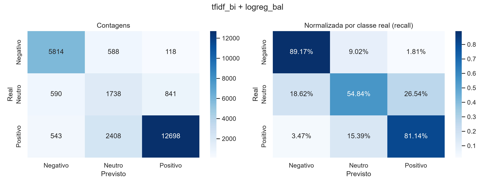

### 7.2 Interpretabilidade Global e Experimento com *Negation Marking*
- **Termos de maior peso nos coeficientes lineares (Figura 11):**
  - *Classe Negativa:* `"não recomendo"`, `"não"`, `"não gostei"`, `"péssimo"`, `"não funciona"`, `"ruim"`, `"nao"`, `"dinheiro"`, `"horrível"`, `"péssima"`.
  - *Classe Neutra:* `"bom"`, `"gostei"`, `"porém"`, `"produto bom"`, `"boa"`, `"mas"`, `"bom produto"`, `"gostando"`.
  - *Classe Positiva:* `"excelente"`, `"ótimo"`, `"ótima"`, `"muito bom"`, `"perfeito"`, `"amei"`, `"adorei"`, `"recomendo"`, `"maravilhoso"`, `"lindo"`.
- **Efeito do *Negation Marking* em unigramas (`notebooks/03_treinamento_modelos.ipynb`):** Unir `"não gostei" → "não_gostei"` melhorou **todas as 8 configurações de unigramas** (ganhos de `+0,0061` a `+0,0124` em F1-Macro), confirmando seu valor quando há restrição de memória, embora `TF-IDF uni+bigramas` permaneça superior (`0,7318` vs. `0,7023`) por capturar também bigramas afirmativos e temporais (`"muito bom"`, `"antes prazo"`).

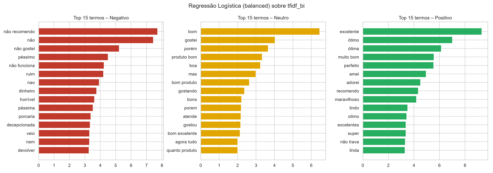

---

## 8. Avaliação Experimental Crítica — Respostas às 5 Perguntas da Seção 2.6

Esta seção (conduzida por **Hillary Maximino** em `src/evaluation.py` e `notebooks/04_avaliacao_e_erros.ipynb`) responde diretamente às cinco perguntas propostas pelo edital sobre o conjunto de teste (`n_test = 25.338`).

### 8.1 Pergunta 1 — Qual configuração apresentou melhor resultado?
A melhor configuração geral foi **TF-IDF (Uni+Bigramas, `sublinear_tf=True`, `min_df=3`) + Linear SVM (`class_weight='balanced'`, `C=0,1`)**, alcançando **F1-Macro = `0,7318`** (`0,7248` em validação cruzada) e **Acurácia = `83,78%`** (`F1-Weighted = 0,8333`).

| Classe | Suporte (`X_test`) | Precisão | Recall (Sensibilidade) | F1-Score |
| :--- | ---: | ---: | ---: | ---: |
| **Negativo (`0`)** | 6.520 | 0,8249 | **0,9138** | 0,8671 |
| **Neutro (`1`)** | 3.169 | 0,4697 | 0,3913 | 0,4269 |
| **Positivo (`2`)** | 15.649 | **0,9066** | 0,8965 | **0,9015** |
| **Média Macro ★** | **25.338** | **0,7337** | **0,7339** | **0,7318** |

**Contraste crítico com a Acurácia e com a LogReg `balanced` (Figura 12):** A Regressão Logística padrão atinge a maior acurácia bruta (`84,52%`), porém colapsa na classe Neutra (`Recall = 22,56%`, `F1-Macro = 0,6993`). Por outro lado, a Regressão Logística `balanced` maximiza o Recall Neutro (`54,84%`), mas sacrifica `2.408` avaliações Positivas reclassificadas como Neutras (`Precisão Neutra = 36,71%`, `Acurácia = 79,92%`). O `LinearSVC(C=0,1, balanced)` atinge o ponto ótimo de Pareto entre sensibilidade às classes minoritárias e precisão global.

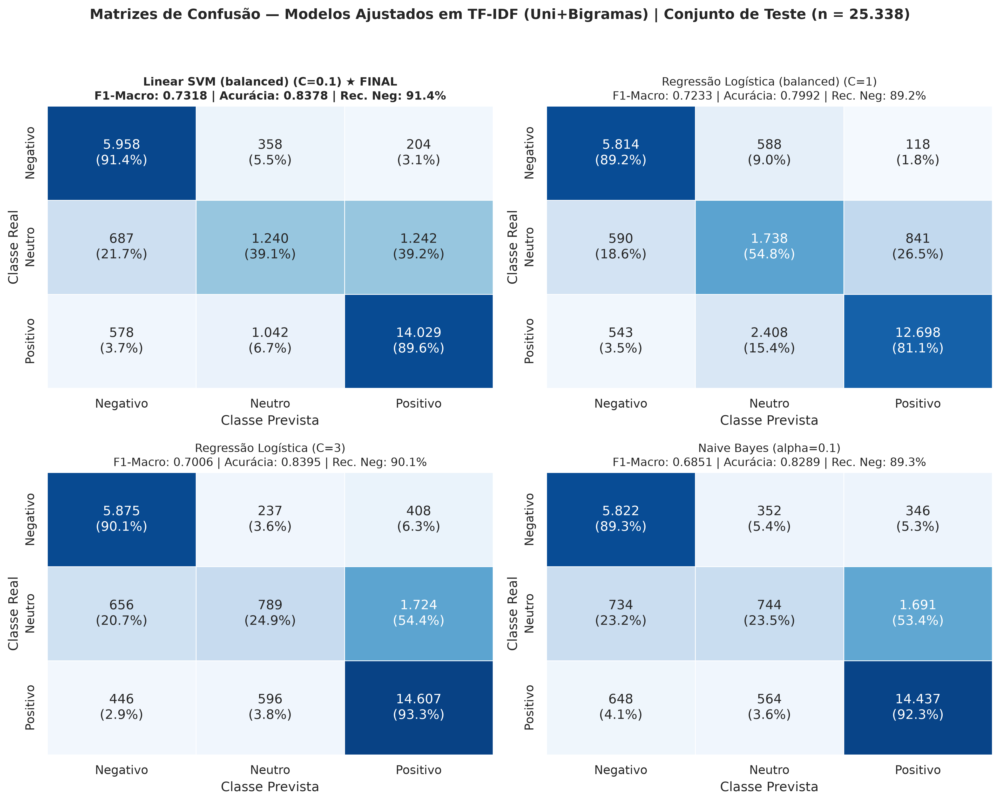

### 8.2 Pergunta 2 — O modelo consegue identificar adequadamente avaliações negativas?
**Sim, com altíssima sensibilidade operacional.** Das **`6.520` avaliações negativas reais** do conjunto de teste, o modelo final detectou corretamente **`5.958` (`91,38%` — maior Recall Negativo entre todas as 20 configurações testadas)**, com `F1 Negativo = 0,8671` (Figura 15):
- `358` casos (`5,49%`) sofreram apenas suavização adjacente para `Neutro`;
- Somente **`204` casos (`3,13%`)** resultaram em inversão polar (`Negativo → Positivo`), sendo expressiva parcela causada por erro de clique do próprio consumidor no corpus original (Seção 8.4).

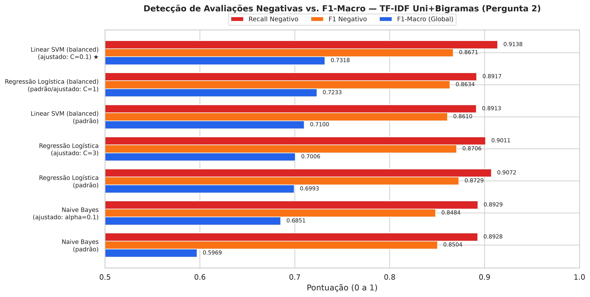

### 8.3 Pergunta 3 — Quais erros aparecem com maior frequência?
O modelo final registrou `21.227` acertos (`83,78%`) e **`4.111` erros (`16,22%`)**. A decomposição completa dos 6 pares de confusão demonstra que **`80,98%` de todos os erros (`3.329` casos) envolvem a classe Neutra** (Figura 14, Painel A):

| Par de Confusão (`Real → Previsto`) | Quantidade | % sobre os Erros | % sobre o Teste | Confiança Média |
| :--- | ---: | ---: | ---: | ---: |
| **Neutro → Positivo** | **1.242** | **30,21%** | 4,90% | 57,62% |
| **Positivo → Neutro** | **1.042** | **25,35%** | 4,11% | 49,38% |
| **Neutro → Negativo** | **687** | **16,71%** | 2,71% | 52,36% |
| Positivo → Negativo | 578 | 14,06% | 2,28% | 48,87% |
| Negativo → Neutro | 358 | 8,71% | 1,41% | 46,28% |
| Negativo → Positivo | 204 | 4,96% | 0,81% | 45,80% |
| **Total** | **4.111** | **100,00%** | **16,22%** | — |

Além da fronteira cinzenta da nota 3, **`1.086` erros (`26,42%`)** foram identificados como **avaliações mistas / multi-aspecto** (elogio ao produto contraposto a falha na entrega ou ressalva introduzida por `"mas"`/`"porém"`), o que também explica por que os textos errados são mais longos (`25,12` palavras em média vs. `22,50` nos acertos).

#### Amostra Auditada de Erros e Divergências Reais em `X_test` (Sem Dados Pessoais)
| # | Padrão Observado | Nota | Rótulo → Previsto | Conf. | Categoria | Avaliação Original em `X_test` |
| :-: | :--- | :-: | :--- | :-: | :--- | :--- |
| 1 | Mista (produto × entrega) | 4 | Positivo → Neutro | 75,0% | Suplementos | *"Produto é bom, porém a entrega não foi entregue no prazo prometido."* |
| 2 | Mista (produto × entrega) | 4 | Positivo → Neutro | 68,7% | TV e Home Theater | *"só atrasou alguns dias a entrega. Porém o produto é bom."* |
| 3 | Mista (produto × atributo) | 3 | Neutro → Positivo | 69,1% | Moda | *"Produto de qualidade , Entrega muito boa ( 7 dias) , mas o tamanho das lentes é pequeno para o meu gosto."* |
| 4 | Ressalva de durabilidade | 4 | Positivo → Neutro | 77,5% | Celulares | *"E um produto bom , inteligente, porem a bateria deveria ter um pouco de durabilidade !"* |
| 5 | Nota 3 com elogio enfático | 3 | Neutro → Positivo | 95,0% | Celulares | *"Amei recomendo e o melhor de tudo câmera perfeita_ e grande e fino maravilhoso"* |
| 6 | Nota 3 com relato grave | 3 | Neutro → Negativo | 93,3% | Wearable | *"Horrível. Depois d um mês d espera, nao veio o produto q eu paguei, veio um outro relógio. E ainda nao devolveram meu dinheiro 1.500 reais..."* |
| 7 | Ruído de clique (1 ★ elogiando) | 1 | Negativo → Positivo | 88,3% | Cama, Mesa e Banho | *"muito boa a entrega bem antes do previsto exelente loja superr recomendo"* |
| 8 | Ruído de clique (5 ★ reclamando) | 5 | Positivo → Negativo | 88,4% | Informática | *"como posso avaliar o produto se consta entregue e não recebi o produto... creio que vou ter entrar no PROCON para resolver."* |

### 8.4 Pergunta 4 — A regra de conversão de notas em sentimentos introduz ruído nos rótulos?
**Sim, de modo estatisticamente comprovado (Figura 14, Painel B):**
1. **Validação cruzada com `recommend_to_a_friend`:** No teste geral, `8,33%` das avaliações nota 1–2 marcaram `recommend == "Yes"`; porém, nos `204` casos em que o modelo previu **Positivo** contra uma nota 1–2, essa contradição salta para **`28,92%` (`3,5×` maior)**. Analogamente, enquanto apenas `1,48%` das notas 4–5 marcaram `recommend == "No"` no teste geral, nos `578` casos previstos como **Negativo** contra uma nota 4–5 a taxa sobe para **`8,48%` (`5,7×` maior)**.
2. **Avaliações pré-uso e inversão de estrelas:** Identificaram-se `99` avaliações com `nota = 1` cujo texto elogia abertamente a compra, `283` avaliações com `nota = 5` contendo reclamações severas, e `180` avaliações nota 4–5 com expressões de pré-uso (`"ainda não testei"`, `"não abri"`, `"não recebi"`).
3. **Experimento controlado no Cenário Binário (sem nota 3 e sem *data leakage*):** Retreinando o mesmo pipeline (`TF-IDF uni+bi + LinearSVC C=0,1 balanced`) apenas sobre `Negativo (1–2)` vs. `Positivo (4–5)` (`n_train = 88.678`, `n_test = 22.169`), a **Acurácia salta de `83,78%` para `94,77%` (`+10,99 p.p.`)** e o **F1-Macro salta de `0,7318` para `0,9388` (`+0,2070`)** (`F1 Negativo = 0,9155`, `F1 Positivo = 0,9621`). Isso comprova que a principal barreira do problema ternário reside na subjetividade da nota 3, e não em deficiência da representação vetorial.

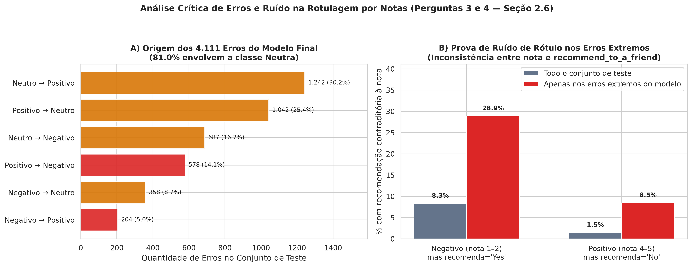

### 8.5 Pergunta 5 — O desempenho se mantém em avaliações de produtos ou categorias diferentes?
Avaliando separadamente as **Top 10 categorias (`site_category_lv1`)** no conjunto de teste (Figura 13), observa-se que a **Acurácia permanece robusta** (`81,89%` a `85,55%`), mas o **F1-Macro apresenta amplitude de `0,0720` pontos** (`0,6920` a `0,7640`), guiada pelo desempenho na classe Neutra:

| Categoria (`site_category_lv1`) | Amostras (`X_test`) | % Neg. | % Neu. | % Pos. | Acurácia | F1-Macro | F1 Neg. | F1 Neu. | F1 Pos. | Rec. Neg. |
| :--- | ---: | ---: | ---: | ---: | ---: | ---: | ---: | ---: | ---: | ---: |
| Utilidades Domésticas | 1.546 | 25,1% | 13,3% | 61,6% | 0,8461 | **0,7640** | 0,8774 | **0,5099** | 0,9046 | 0,8943 |
| Brinquedos | 941 | 27,3% | 12,1% | 60,6% | **0,8555** | 0,7633 | 0,8787 | 0,4977 | 0,9135 | 0,9300 |
| **Móveis** | **1.303** | **42,7%** | **15,8%** | **41,5%** | **0,8289** | **0,7593** | **0,8983** | **0,5051** | **0,8744** | **0,9299** |
| Casa e Construção | 852 | 33,2% | 14,2% | 52,6% | 0,8439 | 0,7523 | 0,8938 | 0,4660 | 0,8972 | **0,9364** |
| Informática | 822 | 28,6% | 15,8% | 55,6% | 0,8224 | 0,7453 | 0,8687 | 0,4848 | 0,8824 | 0,9149 |
| Beleza e Perfumaria | 1.784 | 25,4% | 12,0% | 62,6% | 0,8380 | 0,7322 | 0,8574 | 0,4388 | 0,9004 | 0,9161 |
| Eletroportáteis | 2.317 | 16,9% | 11,4% | 71,6% | 0,8502 | 0,7232 | 0,8407 | 0,4134 | **0,9157** | 0,8954 |
| Informática e Acessórios | 1.447 | 31,8% | 13,0% | 55,2% | 0,8189 | 0,7147 | 0,8859 | 0,3871 | 0,8711 | 0,9196 |
| TV e Home Theater | 1.444 | 22,3% | 10,7% | 67,0% | 0,8255 | **0,6920** | 0,8309 | 0,3455 | 0,8995 | 0,8851 |
| Celulares e Smartphones | 4.055 | 19,2% | 11,5% | 69,3% | 0,8358 | **0,6920** | 0,8314 | **0,3350** | 0,9097 | 0,9038 |

**Interpretação de domínio:** **Móveis**, apesar de concentrar a maior insatisfação do corpus (`42,7%` negativas), obteve o **3º melhor F1-Macro (`0,7593`)** e o **maior F1 Negativo (`0,8983`)**, pois apresenta equilíbrio natural entre classes e vocabulário físico muito explícito (peças faltantes, madeira avariada, montagem). Já **Celulares e Smartphones** e **TV e Home Theater** tiveram o menor F1-Macro (`0,6920`) devido ao `F1 Neutro` reduzido (`0,335–0,346`), reflexo de forte assimetria positiva (~69%) e avaliações técnicas cheias de nuances sobre tela, bateria ou sistema operacional.

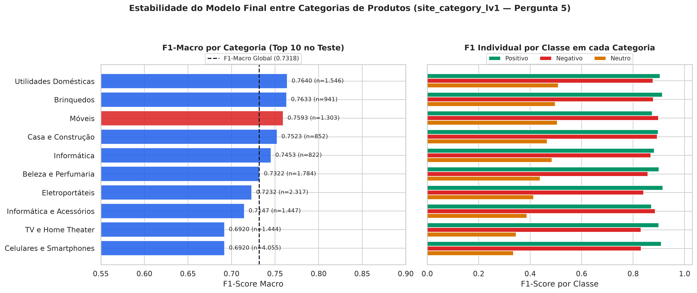

---

## 9. Análise Crítica de Limitações, Vieses e Cuidados Éticos (Seção 2.8)

1. **Ironia, sarcasmo e composição pragmática:** Classificadores lineares sobre *Bag of N-grams* somam pesos independentes. Na validação com frases inéditas (`evaluation_summary.json`), a sentença sarcástica *"Parabéns pela transportadora incrível, só levou dois meses para entregar um produto quebrado"* recebe forte empuxo positivo de `"parabéns"` e `"incrível"`, ilustrando um limite clássico de representações sem atenção contextual profunda.
2. ** Sentimento multi-aspecto (produto vs. logística):** Um único rótulo global comprime opiniões opostas sobre alvos distintos (ex.: *"O celular é ótimo, mas a entrega atrasou duas semanas e veio com a caixa rasgada"*). Como extensão natural (Seção 2.7), recomenda-se *Aspect-Based Sentiment Analysis* (ABSA) ou ajuste fino de *Transformers* em português (ex.: BERTimbau).
3. **Variação ortográfica informal e escopo de negação:** Grafias coloquiais (`"exelente"`, `"nao"` sem til, `"vc"`, `"q"`) diluem pesos em múltiplos tokens, e bigramas não alcançam negações de longa distância (*"Não consigo dizer que a compra foi ruim"*).
4. **Limitações metodológicas e calibração:** Os experimentos utilizam uma única partição 80/20 (diferenças `< 0,01` em F1-Macro não devem ser superinterpretadas como superioridade absoluta). Além disso, como `LinearSVC` não estima probabilidades calibradas nativamente, a interface Streamlit converte `decision_function` via *softmax* apenas como indicador relativo de margem, informando essa distinção de forma transparente ao usuário.
5. **Viés temporal, de plataforma e ético:** O vocabulário reflete o e-commerce da *Americanas.com* em 2018; sua transferência direta para domínios distintos (redes sociais, área médica ou financeira) exige retreinamento e validação externa (ex.: corpus *RePro*). Em produção, o modelo deve apoiar triagem agregada e priorização de atendimento ao consumidor, nunca decisões automatizadas sem revisão humana.

---

## 10. Aplicação Demonstrável em Streamlit (`app.py`) e Testes Automatizados

A aplicação web interativa (`streamlit run app.py`) foi projetada com tema visual moderno (`.streamlit/config.toml`), gráficos interativos *Altair* e cache em memória (`@st.cache_data` e `@st.cache_resource`), estruturada em **três abas**:

### 10.1 Aba 1 — Corpus, Rotulagem Interativa e Laboratório de Pré-processamento
Apresenta cartões de KPIs da auditoria, **simulador interativo da regra de mapeamento** (alternando ao vivo entre 3 classes, cenário binário com comparativo experimental e mapeamento customizado estrela por estrela), **comparador em tempo real de pré-processamento** (destacando visualmente em chips verdes as negações e acentos salvos frente ao NLTK padrão) e sub-abas organizadas para os gráficos `01..08` e funil de limpeza.

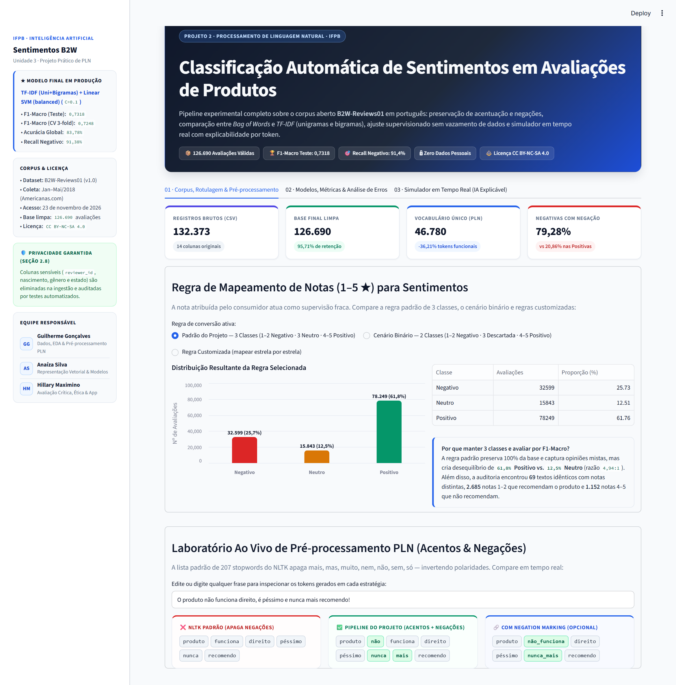

### 10.2 Aba 2 — Comparação de Modelos, Matrizes de Confusão, Categorias e Erros Reais
Reúne o painel do modelo campeão, ranking interativo filtrável das **20 configurações** com gráfico *Altair*, **explorador dinâmico de Matriz de Confusão** para qualquer modelo salvo, painel interativo de estabilidade nas Top 10 categorias e explorador anonimizado de erros reais e ruído de rótulo extraídos de `X_test`.

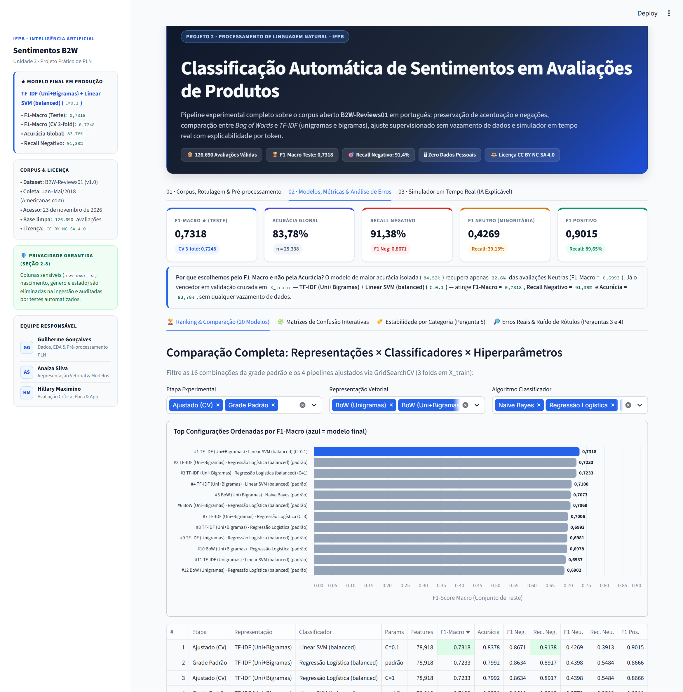

### 10.3 Aba 3 — Simulador em Tempo Real com IA Explicável (XAI)
Permite digitar qualquer avaliação inédita (ou acionar 6 cenários de teste em 1 clique: elogio, negação crítica, avaliação mista, neutro moderado, negação positiva e ironia/sarcasmo), selecionar qualquer classificador/vetorizador e visualizar instantaneamente: classe prevista, barras de confiança, chips de auditoria das negações protegidas, **gráfico divergente dos tokens/bigramas que mais pesaram na decisão (`explain_prediction`)** e consenso simultâneo entre os 4 classificadores ajustados.

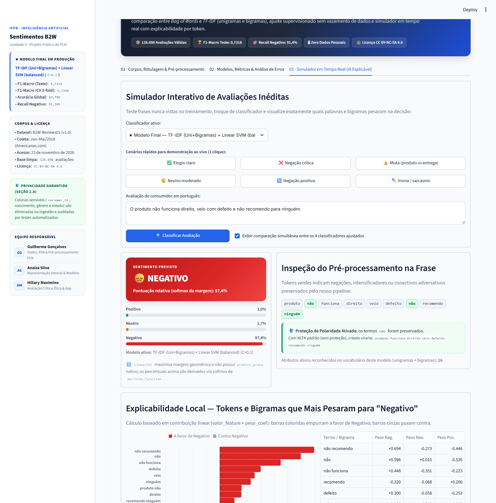

### 10.4 Verificação Automatizada de Ponta a Ponta
A suíte `tests/test_pipeline.py` (`python -m unittest discover -s tests -v`) valida automaticamente `10` cenários integrados: descarte das 4 colunas pessoais, limpeza de duplicatas/nulos, rotulagem ternária e binária, preservação de acentos e negações, *negation marking*, integridade dos 25 artefatos `.joblib`, explicabilidade local nas três famílias de modelos (`LinearSVC`, `LogisticRegression`, `MultinomialNB`), ausência de dados sensíveis nos JSONs e integridade sintática e visual do `app.py`.

---

## 11. Declaração Transparente sobre Uso de IA Generativa (Seção 8 do Edital)

Em cumprimento integral à Seção 8 do edital, a equipe declara de forma transparente que ferramentas de Inteligência Artificial generativa foram utilizadas exclusivamente como **apoio complementar de produtividade, depuração e revisão**:
- **Guilherme Gonçalves (Pessoa 1):** auxílio na organização modular de `src/data_loader.py` e `src/preprocessing.py`, padronização estética dos gráficos exploratórios (`01..08`) e revisão ortográfica/estrutural do texto.
- **Anaíza Silva (Pessoa 2):** apoio na revisão do módulo `src/models.py`, conferência cruzada das métricas reportadas contra `reports/model_results.json` e `notebooks/03_treinamento_modelos.ipynb`, e refinamento redacional.
- **Hillary Maximino (Pessoa 3):** suporte na estruturação de `src/evaluation.py`, na estilização visual da interface `app.py` (CSS/Altair), na suíte `tests/test_pipeline.py` e na consolidação editorial deste relatório.

Todos os pipelines de código, conjuntos de treino e teste, hiperparâmetros, matrizes de confusão, estatísticas de ruído e exemplos reais citados foram **integralmente executados, verificados e validados localmente sobre o corpus real B2W-Reviews01**, sendo todas as decisões metodológicas plenamente compreendidas e explicáveis pelos três integrantes da equipe.

---

## 12. Conclusão

O trabalho cumpriu integralmente os objetivos propostos, demonstrando na prática como cada decisão de engenharia de PLN impacta a classificação de sentimentos em português. A preservação deliberada da acentuação e dos operadores de negação combinada à representação **TF-IDF com unigramas e bigramas** e ao classificador **Linear SVM regularizado e balanceado (`C=0,1`)** permitiu alcançar **`91,38%` de Recall em avaliações negativas** e **`0,7318` de F1-Macro** sobre `25.338` avaliações reais de teste sem vazamento de dados. Mais importante, a investigação crítica comprovou quantitativamente que o teto de desempenho ternário decorre da natureza ambígua e multi-aspecto da nota 3 e do ruído inerente à supervisão por estrelas (como atestado pelo salto para **`0,9388` de F1-Macro** no experimento binário), consolidando um sistema funcional, ético, auditável e transparente.

---

## 13. Referências Bibliográficas

1. AMERICANAS TECH / B2W DIGITAL. **B2W-Reviews01 — Open Corpus of Product Reviews in Portuguese (v1.0)**. GitHub Repository, 2019. Disponível em: <https://github.com/americanas-tech/b2w-reviews01>. Acesso em: 23 nov. 2026. Licença CC BY-NC-SA 4.0.
2. REAL, L.; OGAWA, M.; COELHO, F.; COELHO, L. **B2W-Reviews01: An Open Dataset for Sentiment Analysis in Portuguese**. In: *Symposium in Information and Human Language Technology (STIL)*, Salvador: SBC, 2019, p. 200–205.
3. CHAVES, R. **B2W-Reviews01 — Hugging Face Datasets Mirror**. Disponível em: <https://huggingface.co/datasets/ruanchaves/b2w-reviews01>. Acesso em: 23 nov. 2026.
4. PEDREGOSA, F. et al. **Scikit-learn: Machine Learning in Python**. *Journal of Machine Learning Research*, v. 12, p. 2825–2830, 2011.
5. BIRD, S.; KLEIN, E.; LOPER, E. **Natural Language Processing with Python: Analyzing Text with the Natural Language Toolkit (NLTK)**. Sebastopol: O'Reilly Media, 2009.
6. JURAFSKY, D.; MARTIN, J. H. **Speech and Language Processing** (3rd ed. draft). Stanford University, 2024. Capítulo 4: *Naive Bayes, Text Classification, and Sentiment*.
7. VANDERPLAS, J. et al. **Altair: Interactive Statistical Visualizations for Python**. *Journal of Open Source Software*, v. 3, n. 32, p. 1057, 2018.
8. STREAMLIT INC. **Streamlit Documentation (v1.67)**. Disponível em: <https://docs.streamlit.io/>. Acesso em: 26 nov. 2026.
